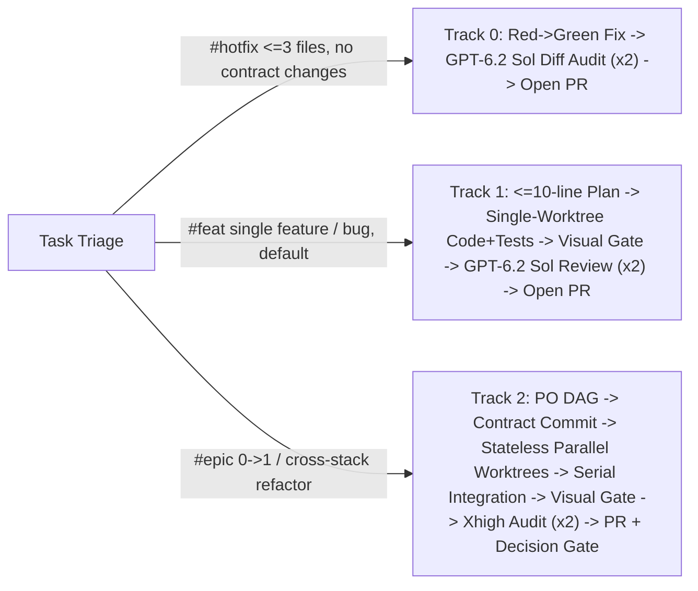

# orca-pod — 3-Track Multi-Model AI Engineering Orchestration Kit

[中文](README.md) | [English](README.en.md) · [中文使用文档](README-CUSTOM.md) | [English Usage Guide](README-CUSTOM.en.md)

**A customized, 3-Track orchestration scaffold built on top of [`vankhangfet/orca-sdlc-kit`](https://github.com/vankhangfet/orca-sdlc-kit) (MIT License).** The upstream core engine (`.orca/flow.mjs` and `.orca/agent-config.mjs`) remains **100% untouched** for painless upstream syncing, while adding a **3-Track Workflow**, **personal multi-model & reasoning-effort routing**, a **Stitch + Open Design MCP frontend Visual Gate**, **cross-family review with a 2-round circuit breaker**, and **GitHub / Gitea headless CI PR summaries via Tencent TokenHub API**.


## What's New & Changed (vs. Upstream `orca-sdlc-kit`)

| Area | Additions / Customizations | Why It Matters |
|---|---|---|
| **3-Track Workflow** | Added `.orca/flow-hotfix.json` (Track 0), `.orca/flow-feature.json` (Track 1, default `flow.config.json`), and `.orca/flow-epic.json` (Track 2) | Right-sizes orchestration: fast surgical fixes for hotfixes, contract-first parallelism for epics |
| **Flexible Model Pool Reference** | All 3-track configs default to `"model": "default"` (zero lock-in; swap in any commercial or open-source model), with a documented reference preset & effort guardrails | Works out of the box with your CLI defaults while preserving cross-family review & avoiding known effort pitfalls |
| **Engineering Standards** | Added `AGENTS.md` and `.worktreeinclude` | Codifies `#hotfix`/`#feat`/`#epic` triage, no direct push/auto-merge to `main`, Red→Green hotfix discipline, Contract-First commits, and Max Retry = 2 |
| **Frontend UI/UX Closed Loop** | Added Stitch-compatible `DESIGN.md` (YAML Tokens + Markdown) & Visual Gate steps | Enforces anti-AI-slop rules, 4-state completeness, component reuse, and Playwright 1440px/390px visual audits |
| **Custom Prompts (Skills)** | Added `.orca/prompts/triage-po.md`, `frontend-worker.md`, and `senior-auditor.md` | Injected dynamically per step via native `flow.mjs` `skills` support and restored cleanly afterward |
| **Headless CI PR Review** | Added `.github/workflows/ci-release.yml` and `.gitea/workflows/ci-release.yml` | Posts Chinese PR risk summaries via **Tencent TokenHub API** without ever putting personal subscriptions in CI runners |
| **Safe Scaffolder (`orca-pod`)** | Extended `bin/init.mjs` & `package.json` whitelist and renamed package to `orca-pod` | Supports `npx github:shown1985/orca-pod`; preserves existing custom files and prints `diff -u` merge hints |

## 3-Track Workflow Overview



| Track | Config File | Best For | Key Guardrails |
|---|---|---|---|
| **Track 0 (Fast Path)** | `.orca/flow-hotfix.json` | `#hotfix` / minor tweaks (≤3 files, no contract changes) | Skips PO, enforces **Red → Green** regression test first, `GPT-6.2 Sol` (High) fast diff audit (Max Retry = 2) |
| **Track 1 (Standard, Default)** | `.orca/flow-feature.json` (default `flow.config.json`) | `#feat` / single clear feature or standard bug | ≤10-line micro plan, single-worktree coding + unit tests, conditional Visual Gate, `GPT-6.2 Sol` (High) review |
| **Track 2 (Full Orchestration)** | `.orca/flow-epic.json` | `#epic` / 0→1 module / cross-stack refactor | **Contract Commit first**, stateless parallel workers + stateful serial integration, `GPT-6.2 Sol` (Xhigh) 2-round cap, **Orca Decision Gate** before merge |

## Quick Start

**Prerequisites:** [Orca ADE](https://www.onorca.dev/) installed and signed in, Node.js >= 18, and your CLI agents (`gemini`, `opencode`, `codex`, etc.) authenticated.

### 1. Install into Any Project Repository

```bash
# Install from GitHub (recommended)
npx github:shown1985/orca-pod

# Or install from your local clone
npx /path/to/orca-pod
```

> Existing project files (`AGENTS.md`, `DESIGN.md`, `.worktreeinclude`, `ci-release.yml`, etc.) are **preserved by default** with `diff -u` merge hints printed. Pass `--force` only if you want to overwrite them.

### 2. Enable Orchestration & Dry-Run

1. In Orca ADE, open **Settings → Experimental** and enable **Orchestration**.
2. Create an isolated worktree for your task.
3. Preview with `--dry-run`, then run:

```bash
# Track 1 (Default Standard Track)
node .orca/flow.mjs --dry-run "#feat Build user preferences page"
node .orca/flow.mjs "#feat Build user preferences page"

# Track 0 (Fast Hotfix Track)
node .orca/flow.mjs --config flow-hotfix.json --dry-run "#hotfix Fix token refresh race condition"

# Track 2 (Full Epic Track with Orca Decision Gate)
node .orca/flow.mjs --config flow-epic.json --dry-run "#epic Add multi-tenant billing module"
```

## Visual Designer & Live Status Dashboard

- **Workflow Designer**: Run `node .orca/designer.mjs` to visually inspect, reorder, and edit pipeline JSON configs.
- **Live Status Page**: Real runs automatically open `.orca/artifacts/status.html` with live step timers, parallel groups, task checklists, artifact viewer, and per-step token usage.


## Documentation

- **[English Usage Guide (`README-CUSTOM.en.md`)](README-CUSTOM.en.md)**: Complete guide to installation, 3-Track switching, model pool & reasoning effort routing, UI/UX Visual Gate, TokenHub CI secrets, and upstream syncing.
- **[中文完整使用文档 (`README-CUSTOM.md`)](README-CUSTOM.md)**: Complete Chinese usage guide.
- **[Engine Schema Reference (`.orca/CONFIGURATION.md`)](.orca/CONFIGURATION.md)**: Full upstream `flow.mjs` config schema (`parallelWith`, `skills`, `mcpServers`, `gate`, `nudge`, `notify.json`).
- **[Troubleshooting (`TROUBLESHOOTING.md`)](TROUBLESHOOTING.md)**: Common issues and `--from` resume commands.

## Syncing Upstream Updates

Because `.orca/flow.mjs` and `.orca/agent-config.mjs` are untouched, syncing upstream improvements is clean and predictable:

```bash
git fetch upstream
git merge upstream/main
```

## License

[MIT](LICENSE)
