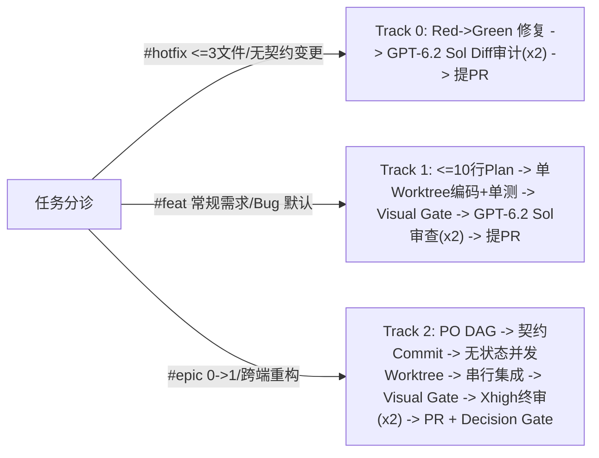

# orca-pod — 三轨多模型 AI 工程编排脚手架

[中文](README.md) | [English](README.en.md) · [中文使用文档](README-CUSTOM.md) | [English Usage Guide](README-CUSTOM.en.md)

**基于开源项目 [`vankhangfet/orca-sdlc-kit`](https://github.com/vankhangfet/orca-sdlc-kit) 深度演进的工程编排脚手架（v0.3.0，MIT License）。** 在三轨工作流与跨家族写审分离的基础上，新增引擎级 **单步隔离 Worktree 并发（`worktree-isolation.mjs`）**、**内容级硬门禁校验（`gate-verify.mjs`）**、**9 类单向门 / Merge Danger 防护（`merge-danger.mjs`）**、**`turnStart: observed` 启动证据 + 5 态健康状态机（`health.mjs`）**，以及 **仓外不可变运行账本 + 四层独立验收 + 8 项 Closeout 结算 + Bot 防撞车锁（`ledger.mjs`）**。


## 最新改动与新增特性（对比上游 `orca-sdlc-kit`）

| 类别 | 新增 / 改造内容 | 核心价值 |
|---|---|---|
| **三轨工作流** | 新增 `.orca/flow-hotfix.json`（Track 0）、`.orca/flow-feature.json`（Track 1，默认 `flow.config.json`）、`.orca/flow-epic.json`（Track 2） | 按任务规模精准分流，避免“小改动走重流水线”或“大重构跳过契约” |
| **模型池与推理强度参考** | 三轨配置默认 `"model": "default"`（不锁死模型，支持任意闭源或开源模型替换），并在注释与文档中提供参考推荐组合与避坑约束 | 开箱即用不报错，同时支持跨家族写审隔离，规避 `GLM-5.3` 默认 Max、`GPT-6.2 Sol` Max 负优化、Carbon/Neon Low 降智 |
| **工程规范与契约纪律** | 新增 `AGENTS.md` 与 `.worktreeinclude` | 固化 `#hotfix`/`#feat`/`#epic` 分诊、禁止直推/自动合并 `main`、Hotfix Red→Green 测试先行、Track 2 契约 Commit 先行与 2 轮熔断上限 |
| **前端 UI/UX 闭环** | 新增 `DESIGN.md`（兼容 Google Stitch YAML Tokens + Open Design MCP）与 Visual Gate 步骤 | 落地反 AI 塑料感红线、四态完整性、组件复用优先与 Playwright 1440px/390px 双端视觉验收 |
| **定制 Prompts (Skills)** | 新增 `.orca/prompts/triage-po.md`、`frontend-worker.md`、`senior-auditor.md` | 通过 `flow.mjs` 原生 `skills` 机制按步骤自动注入并清理，无需硬编码 |
| **无头 CI/CD 审 PR** | 新增 `.github/workflows/ci-release.yml` 与 `.gitea/workflows/ci-release.yml` | 通过 **腾讯 TokenHub API** 自动输出中文 PR 风险摘要，严禁在远端 CI 使用个人订阅账号 |
| **安全安装脚手架** | 扩展 `bin/init.mjs` 与 `package.json` 白名单，更名为 `orca-pod` | 支持 `npx github:shown1985/orca-pod` 一键安装；不覆盖用户已有自定义文件并自动输出 `diff -u` 安全合并提示 |

## 三轨工作流总览



| 轨道 | 配置文件 | 适用场景 | 关键门禁 |
|---|---|---|---|
| **Track 0（极速通道）** | `.orca/flow-hotfix.json` | `#hotfix` / 微调（改动 ≤3 文件、无契约变更） | 跳过 PO、强制 **Red → Green** 测试先行、`GPT-6.2 Sol` (High) Diff 审计（Max Retry = 2） |
| **Track 1（标准通道，默认）** | `.orca/flow-feature.json`（默认 `flow.config.json`） | `#feat` / 单个明确 Feature 或常规 Bug | ≤10 行微型 Plan、单 Worktree 编码+单测、涉 UI 走 Visual Gate、`GPT-6.2 Sol` (High) 审查 |
| **Track 2（完整编排通道）** | `.orca/flow-epic.json` | `#epic` / 0→1 新模块 / 跨端重构 | **契约 Commit 先行**、无状态并发 + 有状态串行集成、`GPT-6.2 Sol` (Xhigh) 2 轮熔断、终点 **Orca Decision Gate** 人工确认合并 |

## 快速开始

**前置依赖**：已安装并登录 [Orca ADE](https://www.onorca.dev/)、Node.js >= 18，以及对应的 CLI Agent（`gemini` / `opencode` / `codex` 等）。

### 1. 一键安装到目标业务仓库

```bash
# 从 GitHub 安装（推荐）
npx github:shown1985/orca-pod

# 或使用本机本地路径安装
npx /path/to/orca-pod
```

> 默认**不会覆盖**业务仓库中已有的 `AGENTS.md`、`DESIGN.md`、`.worktreeinclude`、`ci-release.yml` 等文件，并会在终端给出 `diff -u` 安全合并命令。如需强制覆盖，追加 `--force`。

### 2. 在 Orca ADE 中启用编排并干跑预览

1. 在 Orca 中打开 **Settings → Experimental** 并开启 **Orchestration**。
2. 为当前任务创建独立 Worktree。
3. 先用 `--dry-run` 预览执行计划，再正式运行：

```bash
# Track 1（默认标准通道）
node .orca/flow.mjs --dry-run "#feat 实现用户偏好设置页"
node .orca/flow.mjs "#feat 实现用户偏好设置页"

# Track 0（极速 Hotfix 通道）
node .orca/flow.mjs --config flow-hotfix.json --dry-run "#hotfix 修复登录态刷新竞态"

# Track 2（完整 Epic 编排通道，终点含 Orca Decision Gate）
node .orca/flow.mjs --config flow-epic.json --dry-run "#epic 新增多租户账单模块"
```

## 可视化编排与实时状态面板

- **本地可视化编辑器**：运行 `node .orca/designer.mjs` 打开 Workflow Designer，可拖拽调整步骤与编辑 JSON。
- **实时状态看板**：正式运行时会自动打开 `.orca/artifacts/status.html`，实时展示步骤进度、并行组、任务清单、产物预览与 Token 消耗。


## 详细文档导航

- **[中文完整使用文档 (`README-CUSTOM.md`)](README-CUSTOM.md)**：涵盖安装与合并策略、三轨切换命令、模型池与推理强度避坑清单、前端 Stitch / Open Design MCP 闭环、TokenHub CI Secrets 配置及上游同步指南。
- **[English Usage Guide (`README-CUSTOM.en.md`)](README-CUSTOM.en.md)**：Full English guide for installation, 3-Track workflows, model routing, UI/UX Visual Gate, TokenHub CI, and upstream syncing.
- **[引擎配置 Schema 参考 (`.orca/CONFIGURATION.md`)](.orca/CONFIGURATION.md)**：上游 `flow.mjs` 全字段说明（`parallelWith`、`skills`、`mcpServers`、`gate`、`nudge`、`notify.json` 等）。
- **[故障排查 (`TROUBLESHOOTING.md`)](TROUBLESHOOTING.md)**：常见问题与断点续跑（`--from`）说明。

## 同步上游更新

核心引擎 `.orca/flow.mjs` 与 `.orca/agent-config.mjs` 保持上游原版未修改，可随时拉取上游改进：

```bash
git fetch upstream
git merge upstream/main
```

## License

[MIT](LICENSE)
